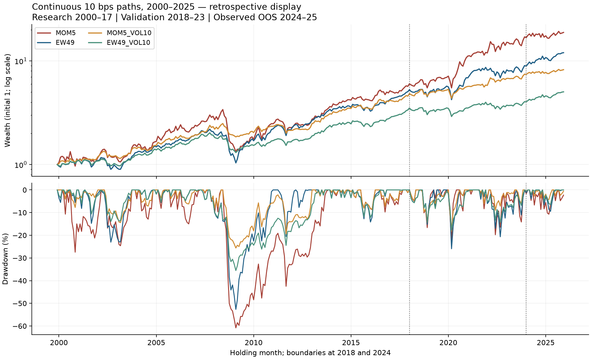
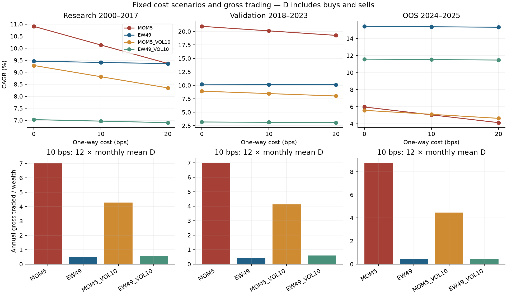
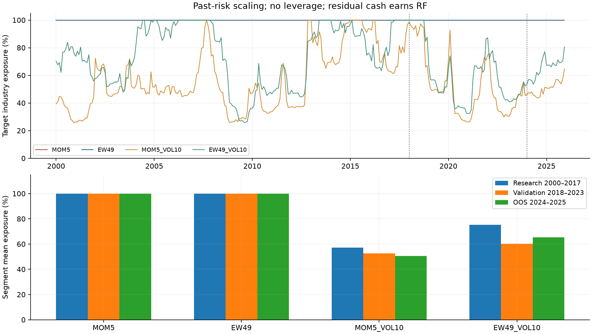
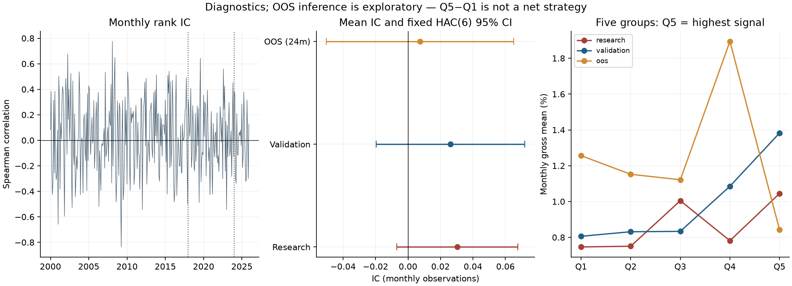
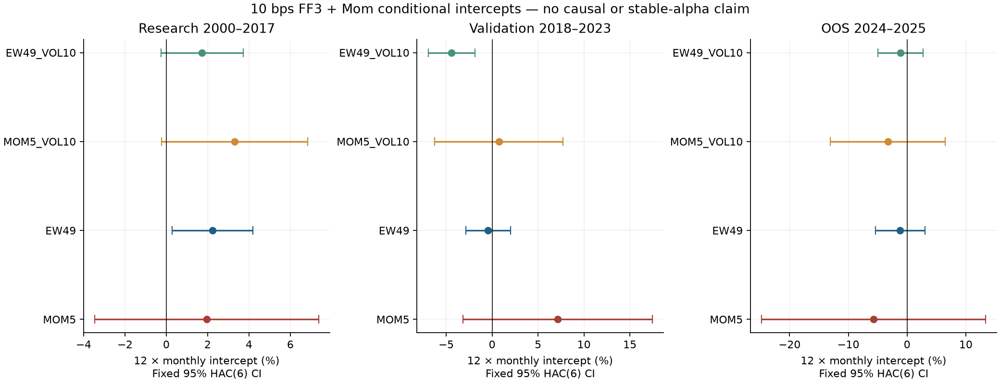

# Cost-aware industry momentum: a frozen-design research study

**AlphaLab Sprint v1 · Owner-authorized complete research presentation**
Study vintage: downloaded 14 October 2026 UTC. Reporting date: 16 October 2026, Australia/Sydney.
Day5 is accepted by HQ. The final interval is **OOS OBSERVED UNDER HQ-D5-001**.

## 1. Research question and decision

Does a simple, monthly industry momentum allocation improve on a broad industry benchmark after explicit allocation costs? Does limiting exposure using past portfolio volatility improve its risk profile? This project evaluates a fixed design rather than searching for the strongest historical configuration. The main comparison is a portfolio of five high-momentum industries, MOM5, against an equal-weight portfolio of all 49 industries, EW49. Each also has a version with a 10% annual volatility target, no leverage and a cash residual. All four portfolios use the same three one-way transaction-cost scenarios: 0, 10 and 20 basis points. The narrative uses 10 bps; every fixed result remains available.

The final 24-month interval was disappointing for momentum relative to its benchmarks. MOM5's 2024–2025 CAGR was **5.0438%**, compared with **15.3700%** for EW49. The scaled portfolios returned **5.1033%** and **11.5225%**, respectively. The mean rank IC and all four main-cost OOS factor-intercept confidence intervals included zero. These are results to retain, not grounds for changing the signal or replacing the final interval.

The specification's H1/H2 propositions receive no stable support across the three segments: positive research or validation point estimates did not establish durable predictive power or benchmark superiority. H3 is treated as a descriptive risk-and-exposure question. Scaling reduced observed drawdowns and exposure, but did not establish alpha or guarantee the target volatility. Technical acceptance means that the stated experiment and evidence passed review; it does not mean that a profitable live strategy was established.

The complete fixed tables, not a selected winner, are the deliverable. This report explains the experiment, separates performance from inference, and records what was actually reproduced. [Specification](../PROJECT_SPEC.md), [fixed experiment list](../config/experiments.json) and [reproduction scope](../docs/REPRODUCIBILITY.md) describe the experiment and evidence boundary.

## 2. Data, vintage and sample chronology

The inputs are the Kenneth French Data Library's 49 industry portfolio returns, Fama–French three factors plus RF, and momentum factor. The parser selects **Average Value Weighted Returns — Monthly** from the industry archive, including distributions; equal-weight and annual tables in the same archive are excluded. “Value weighted” describes securities inside an industry. MOM5 and EW49 allocate equal amounts between selected industry portfolios. These are distinct aggregation levels.

The three original ZIPs are retained in the private research archive, excluded here, and identified by SHA-256 in [data/manifest.json](../data/manifest.json). Source URLs, download UTCs, header text and parser version are preserved. Missing markers −99.99 and −999 are identified before percentage returns are divided by 100 once. Monthly calendars and industry labels must match; missing values, duplicates, non-finite returns, unstable labels and returns below −100% fail the contract. Real negative returns and plausible extremes are not replaced or clipped.

The processed snapshot has 336 months, 49 industries and 16,464 industry-month rows, 1998–2025. Eight partition files separate industry and factor data. The Day6 raw rebuild confirmed the same bytes for every partition and the manifest. Its full-file processing included the holdout's structure and bytes; that was not a new OOS strategy evaluation.

| Interval | Months | Role |
|---|---:|---|
| 1998–1999 | 24 | Warmup; unscaled base returns begin in 1999 |
| 2000–2017 | 216 | Research and implementation assessment |
| 2018–2023 | 72 | Fixed validation |
| 2018–2020 / 2021–2023 | 36 / 36 | Prespecified descriptive validation subdivisions |
| 2024–2025 | 24 | Final authorized evaluation, now observed |

This is a current-vintage retrospective study, not a historical point-in-time reconstruction. The files identify a 202608 CRSP source vintage; historical observations may have been revised. The Day1 source audit records the FIZ-to-CIZ change in 2025 and the implications of daily compounding and dividend reinvestment conventions. The RF source also changes within the official series. Snapshot consistency controls reproducibility but does not eliminate vintage risk. [Data sources](../docs/DATA_SOURCES.md) distinguishes these facts from unverified redistribution permissions.

## 3. Signal, target portfolio and chronological risk rule

For industry i held in month t, momentum is the compound return from t−12 through t−2:
`momentum(i,t) = product(1 + r(i,u), u=t−12,...,t−2) − 1`.
There are eleven monthly observations; month t−1 is deliberately skipped. January 2024 therefore uses January through November 2023. No January holding return is required to decide January's momentum portfolio. Complete monthly windows are required for every industry.

MOM5 takes the five largest signals, breaking exact ties by normalized industry label in ascending order. Each selected industry receives 0.2, even when all signals are negative; there is no positive-momentum filter. EW49 allocates 1/49 to every industry. The tie rule makes selection invariant to input column order. IC inference instead uses average ranks for ties, rather than forcing unique ranks.

For each scaled portfolio, the underlying strategy's actual historical, **unscaled gross** portfolio returns define risk. At t, annualized sigma is the sample standard deviation, ddof=1, of base returns t−12 through t−1, multiplied by sqrt(12). Exposure is `min(1, 0.10/sigma)`, with exposure one at zero sigma. A complete finite twelve-month window is mandatory. The scaled industry weights equal base weights times exposure; remaining capital is cash. MOM5_VOL10 uses historical MOM5 portfolios selected in their own months, not today's constituents backfilled through history. EW49_VOL10 uses EW49's own base returns.

This distinction prevents both look-ahead and recursive risk feedback from fees or prior scaling. Momentum skips t−1, while risk legitimately includes t−1. Changing that last month's return can therefore change current scaled weights. Cash earns contemporaneous RF as an outcome; RF for the holding month does not determine its target weight. The 10% setting is a rule, not an assurance of 10% realized volatility or equal risk across the two scaled strategies.

## 4. Self-financing execution and segment measurement

The model starts January 2000 with wealth one and all cash. It charges initial construction costs; 1999 is risk warmup without fees or scored performance. At later boundaries, NAV and drifted holdings continue. There is no fresh cash restart in January 2018 or January 2024, and no liquidation at the December 2025 endpoint.

With pretrade industry weights b, desired post-cost weights w and one-way rate c, the retained wealth fraction k solves:
`k = 1 − c Σ|k w_i − b_i|`.
Gross traded fraction D is the sum in that equation. Both industry purchases and sales incur costs; D is **not divided by two**. Cash is not separately charged. Allocation costs are paid at the beginning of the month. For target-weight gross return G, including cash RF, net return is `N = k(1+G) − 1`. Hence gross minus net return is `(1−k)(1+G)`, not simply cD.

Post-return industry drift is `w_i(1+r_i)/(1+G)`, with an analogous cash term. The cost factor cancels; using 1+N as the drift denominator would be wrong. The production implementation uses bounded root solving. Earlier synthetic hand calculations and independent Decimal checks corroborated initial investment, full rotation, no-trade and drift rebalancing cases. The cost model covers trades between industry allocations; it excludes turnover inside each industry's securities, impact, taxes, liquidity and capacity.

For each reporting segment, CAGR uses its first `nav_before` and the segment's month count. Maximum drawdown is a nonnegative maximum loss from the running peak, including that segment's initial wealth. Earlier peaks are excluded from segment drawdown. Annual volatility uses net monthly sample standard deviation times sqrt(12). Sharpe uses mean(N−RF)/std(N−RF, ddof=1) times sqrt(12); RF is subtracted once. Active returns compare the same month and cost rate. Annualized mean active return and CAGR difference are different quantities and retain separate field names.

## 5. Fixed performance results

The following values are literal transcriptions of accepted summary files. Volatility and drawdown are percentages; mean exposure is the target industry's share of portfolio wealth. The segment table does not reset funding or holdings.

| Segment | Strategy | CAGR | Vol. | Sharpe | Max DD | Mean exposure |
|---|---|---|---|---|---|---|
| Research 2000–2017 | MOM5 | 10.1336% | 21.2458% | 0.489 | 60.8051% | 100.0000% |
| Research 2000–2017 | EW49 | 9.4088% | 15.8545% | 0.549 | 52.6636% | 100.0000% |
| Research 2000–2017 | MOM5_VOL10 | 8.8146% | 11.2077% | 0.670 | 25.6154% | 57.2935% |
| Research 2000–2017 | EW49_VOL10 | 6.9669% | 10.5527% | 0.542 | 35.5417% | 75.2983% |
| Validation 2018–2023 | MOM5 | 20.1018% | 24.2396% | 0.804 | 22.9645% | 100.0000% |
| Validation 2018–2023 | EW49 | 10.1627% | 20.0347% | 0.496 | 25.9482% | 100.0000% |
| Validation 2018–2023 | MOM5_VOL10 | 8.4651% | 13.2613% | 0.546 | 18.1904% | 52.5945% |
| Validation 2018–2023 | EW49_VOL10 | 3.1338% | 11.9754% | 0.171 | 17.7624% | 60.2218% |
| OOS 2024–2025 | MOM5 | 5.0438% | 16.4506% | 0.096 | 10.7026% | 100.0000% |
| OOS 2024–2025 | EW49 | 15.3700% | 12.2137% | 0.857 | 9.4698% | 100.0000% |
| OOS 2024–2025 | MOM5_VOL10 | 5.1033% | 8.1955% | 0.081 | 4.2561% | 50.5953% |
| OOS 2024–2025 | EW49_VOL10 | 11.5225% | 8.2918% | 0.802 | 6.5232% | 65.4382% |

MOM5's research advantage over EW49 was modest and accompanied by higher volatility and a larger drawdown. Validation showed a substantially stronger return advantage, but that pattern did not persist in the final interval. A high validation CAGR is therefore not sufficient evidence of stable performance. The OOS comparison also remains unfavorable at zero allocation costs, so the gap cannot be attributed solely to the 10 bps assumption.

In OOS, MOM5_VOL10 averaged **50.5953%** industry exposure, versus **65.4382%** for EW49_VOL10. MOM5 scaling reduced maximum drawdown from **10.7026%** to **4.2561%**; the scaled benchmark's drawdown was **6.5232%**. Its CAGR was close to unscaled MOM5 in this particular interval, whereas research and validation scaling reduced returns. These are realized trade-offs, not a forecast that scaling preserves return or a claim that less market exposure generates alpha.

The wealth chart starts at one in December 1999, uses a log vertical scale, and carries holdings and capital through both boundaries. Its drawdown panel is a **continuous retrospective** display and includes earlier peaks; the segment table above instead reports segment-local drawdowns. The vertical lines identify validation and OOS boundaries. The whole path is not a single independent holdout result.

| Strategy | bps | CAGR | Max DD | Annual gross D |
|---|---|---|---|---|
| MOM5 | 0 | 5.9655% | 9.9243% | 8.7353 |
| MOM5 | 10 | 5.0438% | 10.7026% | 8.7313 |
| MOM5 | 20 | 4.1302% | 11.4742% | 8.7272 |
| EW49 | 0 | 15.4212% | 9.4505% | 0.4430 |
| EW49 | 10 | 15.3700% | 9.4698% | 0.4430 |
| EW49 | 20 | 15.3189% | 9.4892% | 0.4430 |
| MOM5_VOL10 | 0 | 5.5730% | 4.0735% | 4.4590 |
| MOM5_VOL10 | 10 | 5.1033% | 4.2561% | 4.4575 |
| MOM5_VOL10 | 20 | 4.6358% | 4.4384% | 4.4561 |
| EW49_VOL10 | 0 | 11.5752% | 6.5032% | 0.4728 |
| EW49_VOL10 | 10 | 11.5225% | 6.5232% | 0.4727 |
| EW49_VOL10 | 20 | 11.4698% | 6.5432% | 0.4726 |

All twelve OOS scenarios are shown, including unfavorable outcomes. Gross trading is economically material for momentum: the 10 bps MOM5 path has annual gross traded fraction **8.7313**. This is twelve times monthly average D, a buy-plus-sell wealth ratio, not “half-turnover.” The full research, validation and OOS cost tables also preserve 0/20 bps for every portfolio.

The same-cost EW49 benchmark is present for every strategy, with EW49_VOL10 additionally used for scaled comparisons. [Active-return appendix](figures/day6_release/active_all_fixed.csv) reports both annualized monthly mean differences and CAGR differences. Neither equals a regression intercept. The market reference is Mkt-RF+RF with no costs; its three main-segment CAGRs are 5.8424%, 11.6127% and 21.2216%. It is an academic total-market series, not an ETF or net-cost investable benchmark.

The fixed validation subdivisions preserve the same continuous path. They are descriptive slices rather than independent portfolio restarts or additional model-selection opportunities.

| Segment | Strategy | CAGR | Max DD |
|---|---|---|---|
| validation_2018_2020 | EW49 | 10.9180% | 25.9482% |
| validation_2018_2020 | EW49_VOL10 | 1.4962% | 17.7624% |
| validation_2018_2020 | MOM5 | 23.5597% | 22.9645% |
| validation_2018_2020 | MOM5_VOL10 | 7.0911% | 18.1904% |
| validation_2021_2023 | EW49 | 9.4126% | 20.6508% |
| validation_2021_2023 | EW49_VOL10 | 4.7978% | 14.3358% |
| validation_2021_2023 | MOM5 | 16.7407% | 19.7736% |
| validation_2021_2023 | MOM5_VOL10 | 9.8567% | 8.9905% |

## 6. Predictive diagnostics and factor attribution

Monthly Spearman IC compares the signal for t with realized industry returns in t, without an extra shift. Groups are sorted by signal ascending with label tie breaks, contain 10/10/10/10/9 industries, and use equal-weight current-month returns. Q5 is the highest-signal group. The gross Q5−Q1 diagnostic is not MOM5, and is not a net tradable long–short strategy.

| Segment | Months / valid | Mean IC | HAC SE | 95% CI |
|---|---|---|---|---|
| research | 216 / 216 | 0.030308 | 0.019018 | [-0.006967, 0.067583] |
| validation | 72 / 72 | 0.026182 | 0.023338 | [-0.019560, 0.071925] |
| oos | 24 / 24 | 0.007453 | 0.029438 | [-0.050245, 0.065152] |

All three mean-IC intervals include zero. The current samples are insufficient to exclude a zero mean; they do not prove that the effect is absent. All IC months were defined, so no missing month was filled with zero or compressed out of the calendar. The effective observation counts for inference are 216, 72 and 24 months, not 49 times those numbers.

Quintile patterns were not uniformly monotonic. In OOS, Q5's monthly gross mean was 0.8425%, compared with Q1's 1.2560%; Q5−Q1 was −0.4135% per month. Q4 exceeded Q5. This weakens a simple ordered-return interpretation without motivating an ex-post change to group definitions. [All diagnostic summaries](figures/day6_release/diagnostics_all_segments.csv) retain both fixed validation subdivisions.

Factor attribution regresses each portfolio's net return minus RF on an explicit intercept, Mkt-RF, SMB, HML and Mom, all in decimal monthly units and aligned one-to-one by month. The already-excess market factor is not adjusted by RF again. OLS uses HAC/Newey–West covariance with six lags, Bartlett weights 1−lag/7, no small-sample correction and normal rather than t inference. Every 95% interval is estimate ±1.96 SE. These choices were fixed before validation results, with no significance screening.

| Segment | Strategy | Annual arithmetic alpha | 95% CI |
|---|---|---|---|
| research | EW49 | 2.2380% | [0.2869%, 4.1891%] |
| research | EW49_VOL10 | 1.7281% | [-0.2593%, 3.7154%] |
| research | MOM5 | 1.9570% | [-3.4607%, 7.3747%] |
| research | MOM5_VOL10 | 3.3048% | [-0.2241%, 6.8337%] |
| validation | EW49 | -0.4389% | [-2.8819%, 2.0042%] |
| validation | EW49_VOL10 | -4.4112% | [-6.9599%, -1.8624%] |
| validation | MOM5 | 7.1388% | [-3.1534%, 17.4309%] |
| validation | MOM5_VOL10 | 0.7322% | [-6.2463%, 7.7107%] |
| oos | EW49 | -1.1900% | [-5.4168%, 3.0367%] |
| oos | EW49_VOL10 | -1.1192% | [-4.9757%, 2.7373%] |
| oos | MOM5 | -5.6981% | [-24.7599%, 13.3637%] |
| oos | MOM5_VOL10 | -3.2680% | [-13.0508%, 6.5148%] |

Alpha is displayed as twelve times the monthly intercept; its standard error and interval are scaled by twelve as well. Betas are not annualized. [All coefficient estimates](figures/day6_release/factor_coefficients_all_fixed.csv) retain all five coefficients, their HAC SEs and intervals, R², dates and sample counts for all 24 research/validation models and 12 OOS models. There are no extra regressions for the validation subdivisions or sensitivity portfolios.

MOM5's research and validation intercept intervals include zero, and both momentum portfolios' OOS intervals are wide and include zero. The table also retains benchmark intervals that exclude zero in particular earlier segments; these do not turn a benchmark or selected configuration into a proven alpha source. Regression intercepts are conditional descriptive quantities, not causal estimates. In a 24-month OOS sample with four factors and a six-lag covariance estimate, precision is limited. No additional model, bandwidth, factor or sample was introduced to obtain significance.

## 7. Prespecified sensitivity and retrospective context

Only two additional paths were authorized before validation: Top10 with the same 12–2 signal, and Top5 with t−6 through t−2, a five-month signal. Both use 10 bps and full industry exposure, with the same exact fees and continuous state. They have no OOS path, no VOL variant and no separate regression grid.

| Segment | Strategy | CAGR | Max DD |
|---|---|---|---|
| research | MOM10_12_2 | 10.2703% | 53.3709% |
| research | MOM5_6_2 | 10.6240% | 53.9979% |
| validation | MOM10_12_2 | 14.8392% | 22.0961% |
| validation | MOM5_6_2 | 17.4787% | 27.5932% |
| validation_2018_2020 | MOM10_12_2 | 18.7478% | 22.0961% |
| validation_2018_2020 | MOM5_6_2 | 21.1525% | 27.5932% |
| validation_2021_2023 | MOM10_12_2 | 11.0592% | 17.2398% |
| validation_2021_2023 | MOM5_6_2 | 13.9163% | 15.6773% |

Both alternatives are kept regardless of their research or validation standing. Their results demonstrate that changing concentration or lookback changes the realized path; they do not select a replacement for the frozen MOM5 experiment. The original and same-cost benchmark comparisons are retained in the [sensitivity active appendix](figures/day6_release/sensitivity_active_research_validation_only.csv).

The following 2000–2025 summaries are **retrospective**, calculated by the accepted Day5 implementation from the full continuous path. They include research and validation observations already used in the workflow. The full-period momentum return is not an independent success criterion and does not override the negative final comparison.

| Strategy | CAGR | Max DD |
|---|---|---|
| EW49 | 10.0305% | 52.6636% |
| EW49_VOL10 | 6.4107% | 35.5417% |
| MOM5 | 11.9497% | 60.8051% |
| MOM5_VOL10 | 8.4440% | 25.6154% |

All twelve full-period scenarios, market reference and active-return comparisons remain in machine-readable appendices. No whole-sample optimization or new full-sample inference was performed for this report.

## 8. Evidence, bounded reproduction and practical limits

The frozen numerical implementation preceded final evaluation. There were exactly two historical formal OOS runs: the first evaluation and one identical-input reproduction. Their 22 stable files matched. The repeat was not another independent sample. Original authorization and operational evidence remain in the private archive; they are not public launch permissions.

The earlier reproduction exercise rebuilt the same raw snapshot into eight processed files, then reproduced fixed results through 2023 in a fresh dependency environment against preseeded references on the same Mac. It reused a base interpreter, was not an empty-output reconstruction, and did not rerun the final test. All 28 Day4 stable hashes matched. This supports the recorded scope, not a new-machine or cross-OS guarantee.

The public repository retains numerical source/configuration/tests for reading. Full raw/processed inputs, historical Git objects, authorizations and private evidence are excluded. The native research freeze chain is deliberately not bypassed. Root research tests and production entry points are outside this package's supported demonstration path. The runnable path is the [read-only walkthrough](../tools/walkthrough/README.md) and its small synthetic/static tests. The [Synthetic demo guards workflow](https://github.com/lapsapbin/AlphaLabSprintV1/actions/workflows/demo-ci.yml) records its actual remote status; this report does not infer CI success from local checks.

All five figure groups and all fixed aggregate tables are accepted existing artifacts. Displaying them is not a new backtest or statistical fit. Public display manifests are labeled derivatives; original manifest hashes remain in source mapping. See [reproducibility](../docs/REPRODUCIBILITY.md) and [source mapping](../PUBLIC_SOURCE_MAP.json).

Limits remain substantial: revised current-vintage data rather than historical PIT, idealized monthly information availability, non-tradable industry research portfolios, concentration risk, and allocation costs excluding internal turnover, market impact, taxes and capacity. Lower exposure is not alpha. A 24-month final interval has limited statistical power. The negative-to-mixed result remains the result; no replacement winner was selected.

The owner has authorized publication of this complete research presentation: project implementation, analysis and independently calculated research outputs. Raw/processed source data and input slices are excluded. No general French/CRSP redistribution authorization, legal clearance or additional software license is claimed. Attribution and publication do not themselves grant third-party data rights. See [rights status](../docs/RIGHTS_STATUS.md). No live trading or production readiness is claimed.
